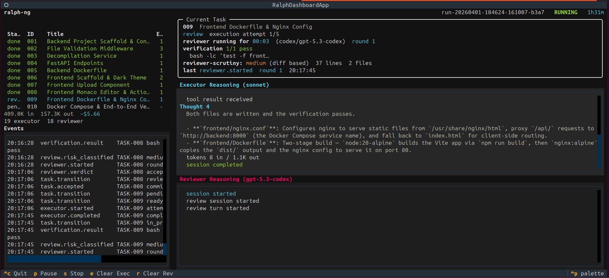

# ralph-ng

`ralph-ng` is a local autonomous coding orchestrator for running approved implementation plans inside a git repository with durable state, adversarial review, bounded repair loops, and a live Textual dashboard.



It coordinates multiple AI models, local verification commands, and recovery logic so long-running coding sessions can survive interruption and keep a readable audit trail.

## Origins

`ralph-ng` builds on the original [`ralph`](https://github.com/snarktank/ralph) loop project and later workflow experiments such as [`awesome-ai-workflow`](https://github.com/jfmaes/awesome-ai-workflow/tree/v1.1). Credit goes to the original `ralph` project for proving that a simple autonomous coding loop could take a repo from prompt to committed code; `ralph-ng` extends that idea with persisted state, cross-model review, challenge rounds, and a live operator dashboard.

## What it does

1. **Reads a plan** — a YAML file with tasks, dependencies, acceptance criteria, and verification commands
2. **Executes tasks** — sends each task to an executor model (Claude) that writes code
3. **Reviews adversarially** — an independent reviewer model (Codex) examines the diff without seeing executor reasoning
4. **Challenges and repairs** — bounded challenge rounds where the executor fixes findings and the reviewer re-evaluates
5. **Commits and continues** — accepted tasks are committed; rejected tasks are repaired or escalated
6. **Self-heals** — classifies failures, diagnoses root causes, auto-fixes project dependencies
7. **Survives interruption** — graceful pause/stop, force-kill recovery, stale controller adoption

## Installation

`ralph-ng` is currently released repo-first. Clone the repository to get the
orchestrator together with the bundled `skills/` workflows.

For local development from a checkout:

```bash
git clone https://github.com/jfmaes/ralph-ng.git
cd ralph-ng
python3 -m venv .venv
.venv/bin/pip install -e '.[dev]'
.venv/bin/ralph --help
```

For a regular local install from the repo without editable mode:

```bash
git clone https://github.com/jfmaes/ralph-ng.git
cd ralph-ng
python3 -m pip install .
ralph --help
```

If you want to build a distributable artifact locally:

```bash
python3 -m build
python3 -m pip install dist/ralph_ng-0.1.0-py3-none-any.whl
ralph --help
```

## Quickstart

Inside a git repository with `ralph-plan.yaml` and `ralph.toml`:

```bash
ralph start                          # start a new run
ralph start --number-of-tasks 4      # stop cleanly after 4 completed tasks
ralph status --run-id <id>           # dashboard snapshot
ralph status --run-id <id> --json    # machine-readable status
ralph watch --run-id <id>            # attach to a running instance
ralph resume --run-id <id>           # resume after interruption
ralph resume --run-id <id> --number-of-tasks 2  # resume for 2 more tasks
ralph stop                           # pause the active run
ralph preflight                      # check environment before starting
ralph doctor --run-id <id>           # diagnose a run's health
ralph validate-plan                  # validate plan YAML
```

Runtime state is written under `.git/ralph/`.

## External Dependencies

`ralph-ng` is a Python package, but it orchestrates external model CLIs. A
working installation also needs the provider binaries you configure in
`ralph.toml`, typically:

- `claude` for the executor
- `codex` for the reviewer

Run `ralph preflight` before starting a run to confirm the configured binaries
and verification tools are present.

## Skills

The repository also includes a top-level `skills/` directory with
model-agnostic Markdown-plus-script workflows such as plan conversion, plan
repair, run triage, and repo initialization.

Those skills are not a runtime dependency of the `ralph` CLI itself, but they
are part of the intended repository workflow and are shipped with the repo
release. `ralph start`, `resume`, `watch`, and the rest do not read from
`skills/` at runtime; the skills are companion workflows for planning, repair,
triage, and initialization.

## Architecture

```
ralph start → Orchestrator._run_loop()
  ├─ Scheduler picks next task from plan
  ├─ Executor (Claude) implements the task
  ├─ Verification commands run locally
  ├─ Reviewer (Codex) examines the diff independently
  ├─ Challenge round if confidence is low or findings are critical
  ├─ Accept → commit → next task
  ├─ Reject → repair loop → retry
  └─ Escalate → human intervention with structured guidance
```

### Adapter Layer

```
Transport (ABC)              ← provider-neutral invocation interface
  ├─ CliClaudeTransport      ← claude -p <prompt> --output-format stream-json
  └─ CliCodexTransport       ← codex exec --json <prompt>

Adapter (ABC)                ← role-specific wrapping + retry logic
  ├─ ClaudeExecutorAdapter   ← retry on malformed output
  └─ CodexReviewerAdapter    ← JSON schema enforcement, parse retry

Factory                      ← builds adapters from ralph.toml [roles] config
```

Adding a new provider requires only a new `Transport` implementation — no adapter or orchestrator changes.

### Streaming Pipeline

Provider CLI output flows through a multi-stage pipeline to the live dashboard:

```
Provider CLI (JSONL stdout)
  → Transport._extract_activity()     # parse events, buffer text
  → LiveActivityTracker.push()        # bounded deque, thread-safe
  → Orchestrator sink                 # persist to JSONL as provider events
  → TUI reads ProviderEventStore      # collapse thought blocks, render
  → Full-width reasoning panes        # numbered thoughts with styled text
```

Reasoning arrives as streaming deltas grouped into **thought blocks**. The TUI collapses partial updates and displays them with numbered headers:

```
Thought 1
  Let me analyze the authentication module...
  The issue is in JWT validation on line 42.

Thought 2
  I'll fix the validation and add a test case.
```

### State Model

All state lives in SQLite (`.git/ralph/state.db`) with WAL journaling:

| Table | Purpose |
|-------|---------|
| `runs` | Run metadata, controller PID, heartbeat, stop reason |
| `task_states` | Task FSM state, attempt count, failure classification |
| `attempts` | Per-attempt artifacts (prompt, patch, review paths) |
| `invocations` | Provider call records (tokens, duration, exit status) |
| `recovery_attempts` | Self-healing diagnosis and auto-fix audit trail |

### Task Lifecycle

```
PENDING → READY → IN_PROGRESS → REVIEW → DONE
                       │            │
                       │            ├─→ REPAIR → IN_PROGRESS (retry)
                       │            ├─→ BLOCKED_HUMAN (escalated)
                       │            └─→ BLOCKED_SYSTEM (provider failure)
                       └─→ BLOCKED_SYSTEM (executor failure)
```

## Reliability

### Failure Classification

Every provider failure is classified into one of 15 categories (e.g., `PROVIDER_CRASH`, `PROVIDER_TIMEOUT`, `VERIFICATION_MISSING_BINARY`) with evidence-based rules. Each class maps to a recovery policy with bounded retries.

### Self-Healing

When enabled (default), failed tasks trigger a bounded diagnosis session:
1. A separate provider analyzes the failure evidence
2. If auto-fixable (project deps, verification rewrites): runs the fix commands
3. If not: enriches the error message for human escalation

Allowed auto-fixes: `npm install`, `pip install`, manifest updates, portable command rewrites.
Never allowed: `sudo`, `apt`, `brew`, destructive git, credential setup.

Configure in `ralph.toml`:
```toml
[self_healing]
enabled = true
diagnosis_provider = "claude"
diagnosis_model = "opus"
max_diagnosis_per_task = 1
max_auto_fix_actions_per_task = 2
```

### Signal Handling

| Input | Behavior |
|-------|----------|
| First `Ctrl+C` | Pause at next checkpoint, SIGTERM to subprocess |
| Second `Ctrl+C` | Force kill children, release controller, exit |
| TUI `p` | Pause at checkpoint, dashboard stays open |
| TUI `s` | Stop at checkpoint, dashboard closes |
| TUI `q` / `Ctrl+C` | Stop + close dashboard |
| `ralph stop` | Write control file, controller pauses at next checkpoint |
| `SIGTERM` | Same as second `Ctrl+C` |

### Resume Recovery

| Prior State | Workspace | Action |
|-------------|-----------|--------|
| `IN_PROGRESS` | Clean | Restart task (attempt not counted) |
| `IN_PROGRESS` | Dirty | Auto-reset to HEAD, restart |
| `REVIEW` | Any | Resume reviewer |
| `REPAIR` | Any | Resume repair (rejection count preserved) |
| `BLOCKED_SYSTEM` | Clean | Retry from READY |
| `paused` | Any | Continue from last checkpoint |
| Stale `running` | Any | Auto-adopt dead controller |

### Controller Ownership

Each run tracks its controller PID and heartbeat (updated every 5s). On `ralph start` or `ralph resume`, stale controllers (dead PID or heartbeat > 30s) are automatically adopted. File locking prevents concurrent starts.

## Prompts

All prompts are in `src/ralph_ng/prompts/`. Key design choices:

- **Executor** (`prompt_builder.py`): dependency management contract, portable tool preference, verification checklist
- **First-pass reviewer** (`reviewer_first_pass.py`): independence protocol, anti-sycophancy rules, severity calibration, single-output enforcement
- **Challenge executor** (`challenge_executor.py`): repair-first-then-explain, environment fix permission
- **Challenge reviewer** (`challenge_reviewer.py`): evaluate NEW diff independently, accept corrections with evidence
- **Diagnostic debugger** (`diagnostic_debugger.py`): failure classification, auto-fix scope, structured JSON output

See `docs/prompts.md` for the complete reference with schemas and construction flow.

## Configuration

Minimal config (`ralph.toml`):
```toml
[ralph]
branch_prefix = "ralph/"
max_retries_per_task = 5
# Use only if your default executor is a less capable model.
# auto_escalate = 4
auto_escalate_model = "opus"

[models]
executor = "opus"
cli = "claude"

[timeouts]
executor_call_seconds = 600
reviewer_call_seconds = 300
```

Mixed-provider config with adversarial review:
```toml
[roles.executor]
provider = "claude"
model = "opus"
cli_path = "claude"

[roles.reviewer]
provider = "codex"
model = "gpt-5.3-codex"
cli_path = "codex"

[review]
enabled = true
[review.thresholds]
auto_accept_min_confidence = 0.95
challenge_below_confidence = 0.80
[review.escalation]
max_rejection_loops = 3
```

See `docs/examples/ralph.toml.mixed-provider.example` for the full annotated config.

## Trust Boundary

Operator-authored verification commands are intentionally shell-executed — the plan is trusted input. Reviewer-added ratchet commands pass through dangerous-pattern checks and executability validation before being stored as overlays.

Self-healing auto-fix commands are restricted to a safe allowlist (package installs, portable rewrites). System-level commands (`sudo`, `apt`, etc.) are always blocked.

## Documentation

- Architecture guide: `docs/architecture.md`
- Prompt reference: `docs/prompts.md`
- Skills guide: `skills/README.md`
- Reliability hardening spec: `docs/plans/2026-03-21-reliability-hardening-spec.md`
- Example configs: `docs/examples/`
- v0.2 spec: `docs/plans/2026-03-20-claude-executor-codex-reviewer-spec.md`

## Repo Layout

```
src/ralph_ng/
  adapters/              Transport and adapter implementations
  prompts/               All prompt templates
  providers/             Provider event persistence
  cli.py                 CLI commands (start, resume, stop, doctor, etc.)
  orchestrator.py        Core loop, task execution, review, challenge
  state.py               SQLite state store
  config.py              TOML config loading and validation
  failure.py             Failure classification and recovery policy
  self_healing.py        Diagnosis sessions and auto-fix engine
  preflight.py           Environment validation
  resume.py              Resume reconciliation
  tui.py                 Textual live dashboard
  progress.py            Rich progress rendering
  ratchet.py             Verification command overlay management
  verification.py        Local command execution
  review_findings.py     ReviewFindings/FindingResponse schemas
  risk.py                Diff risk classification
  git_manager.py         Git operations
  fsm.py                 Task state machine
  scheduler.py           Dependency-aware task scheduling
  plan.py                Plan loading
  validation.py          Plan validation
  events.py              Event logging
  review_bundle.py       Review context assembly
  prompt_builder.py      Executor prompt construction
  utils.py               Shared utilities
tests/                   433 tests
docs/                    Architecture, prompts, specs, examples
skills/                  Agent workflows and helper scripts
```
